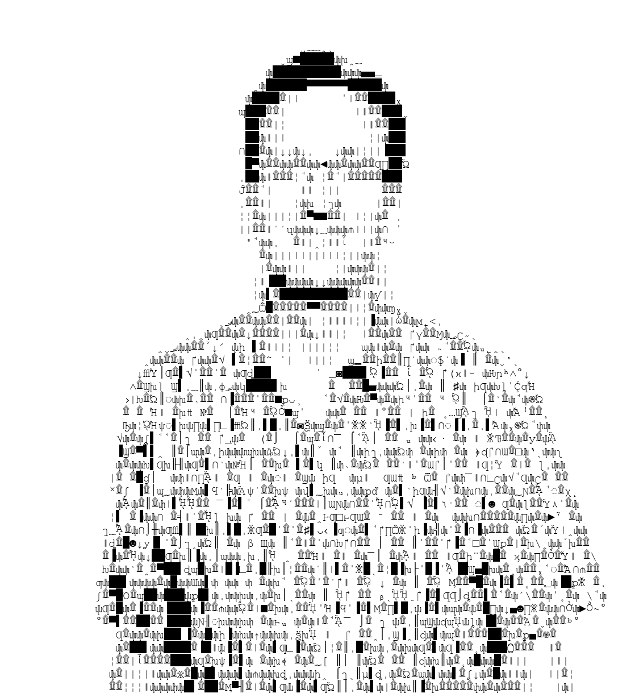
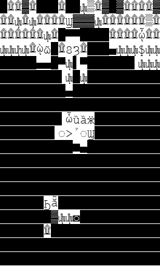

# img-to-txt: pictures drawn with font characters

Rebuild any image out of the characters of a font. Give it a photo and a font, and it redraws the photo line by line using whichever letter, symbol or box-drawing character looks most like each patch of the image.

By **Russ Gatrell**. I wrote the first version in 2019 and have rebuilt it since.

<p align="center"></p>
<p align="center"><em>A self-portrait made with an early version (2019): every mark is a character from a font.</em></p>

## A trick of scale

<a href="mona_lisa_closeup.png"></a>

Shown this small, it's obviously the Mona Lisa. **Click it to see it up close,** where it falls apart into a wall of black blocks and stray letters you'd never recognize.

Made in 2019 with Courier at 20 pt, with the source image scaled to 10%. At that size each character has to stand in for a big patch of the painting, so the picture only comes back when your eye blends the characters together again.

<br clear="left">

## How it works

1. Every character the font supports is drawn to a small bitmap (there can be tens of thousands). The set is cached, so the next run with that font and size starts right away.
2. Characters are grouped by width so a whole group can be compared at once with NumPy.
3. The source image is cut into rows one line tall. Each row is filled left to right with the character that best matches that spot.
4. You get the result as text and as a rendered PNG, plus an optional map of every character that was available.

## Features

- A web interface (Gradio) with font previews, size and scale sliders, and a choice of character sets: plain ASCII, Latin with accents, or every character the font has
- A command-line version for batch runs
- Optional blur when matching, and an optional black-and-white dither for a high-contrast look
- Works with any TrueType or OpenType font on your machine

## Quick start

```bash
python -m venv .venv
.venv\Scripts\activate          # macOS/Linux: source .venv/bin/activate
pip install -r requirements.txt

python app.py                    # opens the web interface at http://127.0.0.1:7860
```

Command line:

```bash
python img_to_txt.py photo.jpg --font courbd.ttf --size 40 --scale 2
python img_to_txt.py photo.jpg -r 32-126 --bw --charmap --show
```

| Option | What it does |
|---|---|
| `-f, --font` | font file or name (searches the Windows font folders) |
| `-s, --size` | font size in points (default 40) |
| `--scale` | resize the source image before converting |
| `-r, --range` | Unicode range to draw from, e.g. `32-126` or `0x2500-0x259F` |
| `--blur` | blur both sides when matching, for smoother tones |
| `--bw` | dither to black and white first |
| `--charmap` | also save an image of every character used |
| `-o, --out-dir` | where results go (default `./output`) |

## Requirements

Python 3.10+, Pillow, NumPy, fontTools and Gradio (see `requirements.txt`).

## License

MIT. See [LICENSE](LICENSE).
